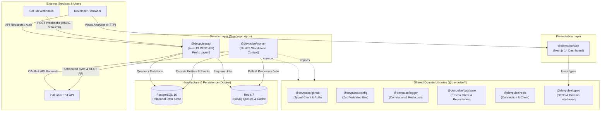
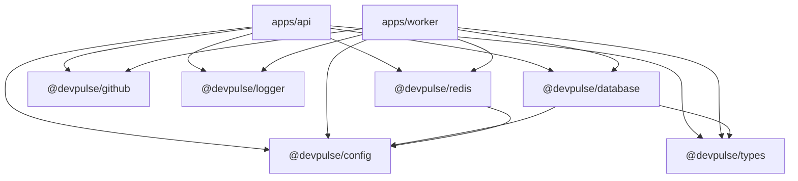
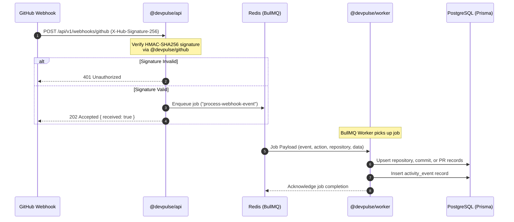
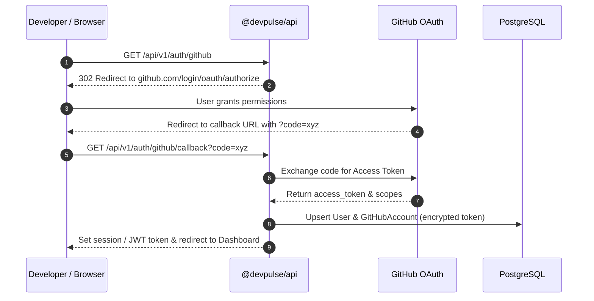

# System Architecture Overview

This document provides a comprehensive overview of the **DevPulse** architecture, system topology, component interactions, data flows, and design principles.

---

## 1. System Purpose & Objectives

DevPulse is an engineering intelligence and developer productivity platform. It connects with GitHub organizations and repositories, captures developer activities (commits, pull requests, code reviews, issues, and workflow runs) in real time and via periodic synchronization, computes engineering velocity and cycle-time metrics, and visualizes them through an intuitive analytics dashboard.

### Core Goals
- **Real-Time Visibility**: Instant visibility into team velocity, cycle time, PR review times, and bottlenecks.
- **Asynchronous Scalability**: Non-blocking ingestion of high-volume GitHub events via Redis message queues and dedicated background workers.
- **Strong Isolation**: Clear boundaries between HTTP REST services, background workers, and shared domain libraries within a unified monorepo.
- **Production Resilience**: End-to-end health checking, structured JSON logging with correlation IDs, centralized configuration validation, and timing-safe webhook processing.

---

## 2. High-Level Architecture Diagram

The following diagram illustrates the complete end-to-end topology of DevPulse:



---

## 3. Monorepo Organization

DevPulse is organized as a high-performance monorepo managed with **pnpm workspaces** and **Turborepo** (`turbo.json`).

```text
DevPulse/
├── apps/
│   ├── api/            # NestJS REST API (port 3000/3001)
│   ├── web/            # Next.js 14 frontend dashboard
│   └── worker/         # Standalone NestJS background worker (BullMQ)
├── packages/
│   ├── config/         # Centralized configuration with Zod validation
│   ├── database/       # Prisma schema, migrations, seed, and ORM client
│   ├── eslint-config/  # Shared ESLint configuration
│   ├── github/         # GitHub API client, OAuth handlers & webhook verification
│   ├── logger/         # Structured logger with correlation ID tracing & redaction
│   ├── redis/          # Shared Redis connection and helper client
│   └── types/          # Domain models, enums, DTOs, and health interfaces
├── infrastructure/
│   ├── docker/         # Docker Compose and container definitions
│   └── scripts/        # Dev tooling and automation scripts
└── docs/               # Project and architectural documentation
```

### Monorepo Boundaries & Dependency Graph



---

## 4. Subsystems & Component Responsibilities

### 4.1. Web Application (`apps/web`)
- **Technology**: Next.js 14 (App Router), React 18, Tailwind CSS, Lucide React.
- **Responsibilities**:
  - Delivers modern analytics dashboards for cycle times, PR turnaround, review delays, and team throughput.
  - Communicates with `@devpulse/api` over authenticated HTTP REST requests.
  - Visualizes team velocity, active repositories, and recent developer activity streams.

### 4.2. REST API Application (`apps/api`)
- **Technology**: NestJS 10, Express, Class-Validator, RxJS.
- **Global Route Prefix**: `/api/v1`
- **Responsibilities**:
  - Serves REST endpoints for organizations, workspaces, repositories, metrics, and health probes.
  - Ingests incoming GitHub webhooks (`POST /api/v1/webhooks/github`), verifies HMAC SHA-256 signatures, and immediately enqueues them to BullMQ.
  - Provides OAuth endpoints for authenticating users and linking GitHub profiles.
  - Implements uniform error handling via `GlobalExceptionFilter`.
  - Exposes comprehensive health check endpoints (`/api/v1/health`, `/health/live`, `/health/ready`).

### 4.3. Background Worker (`apps/worker`)
- **Technology**: NestJS Standalone Application Context, BullMQ 5, ioredis.
- **Responsibilities**:
  - Consumes jobs from Redis queues without HTTP request overhead.
  - Processes GitHub webhook payloads asynchronously (e.g. updating commits, pull requests, reviews, and activity event tables).
  - Runs periodic schedulers (`SchedulerService`) to synchronize repository data and recalculate aggregate metrics.
  - Implements graceful shutdown listeners (`SIGINT`, `SIGTERM`) to allow inflight jobs to finish before exit.

### 4.4. Shared Domain Packages (`packages/*`)

| Package | Role & Responsibility |
|---|---|
| `@devpulse/config` | Loads, parses, and validates 8 configuration domains with Zod schemas. Enforces presence of strong secrets in production. |
| `@devpulse/database` | Houses the Prisma schema, generated `@prisma/client`, database migrations, and idempotent database seed scripts. |
| `@devpulse/github` | Strongly typed wrapper around the GitHub REST API. Handles token exchange, client-side rate limit tracking (`x-ratelimit-*`), exponential backoff, and timing-safe webhook verification. |
| `@devpulse/redis` | Provides a unified Redis connection client factory and connection manager shared across API and Worker. |
| `@devpulse/logger` | Structured logger supporting log levels (`fatal`, `error`, `warn`, `info`, `debug`, `trace`), sensitive key redaction, and request correlation IDs. |
| `@devpulse/types` | Central repository of TypeScript types, DTO contracts, enums (e.g. `UserRole`, `RepositoryStatus`, `HealthStatus`), and shared interfaces. |

---

## 5. End-to-End Data Flows

### 5.1. GitHub Webhook Ingestion & Processing



### 5.2. User Authentication & GitHub Linking Flow



---

## 6. Security & Operational Architecture

1. **Defense in Depth**:
   - Webhook requests are validated using cryptographic constant-time comparison (`crypto.timingSafeEqual`) to prevent timing side-channel attacks.
   - Database credentials, Redis URLs, and OAuth secrets are encapsulated server-side and never exposed to the Next.js client bundle.
2. **Correlation & Observability**:
   - Every incoming HTTP request receives an `x-request-id` header (or generates a UUID).
   - The `@devpulse/logger` automatically attaches this correlation ID to all log entries, facilitating distributed debugging.
3. **Resilient Health Probes**:
   - Microservice container orchestration (Kubernetes, Docker Swarm, AWS ECS) is supported with dedicated liveness (`/api/v1/health/live`) and readiness (`/api/v1/health/ready`) endpoints.
   - Individual dependency check failures do not crash the health service; all components are evaluated and aggregated.
