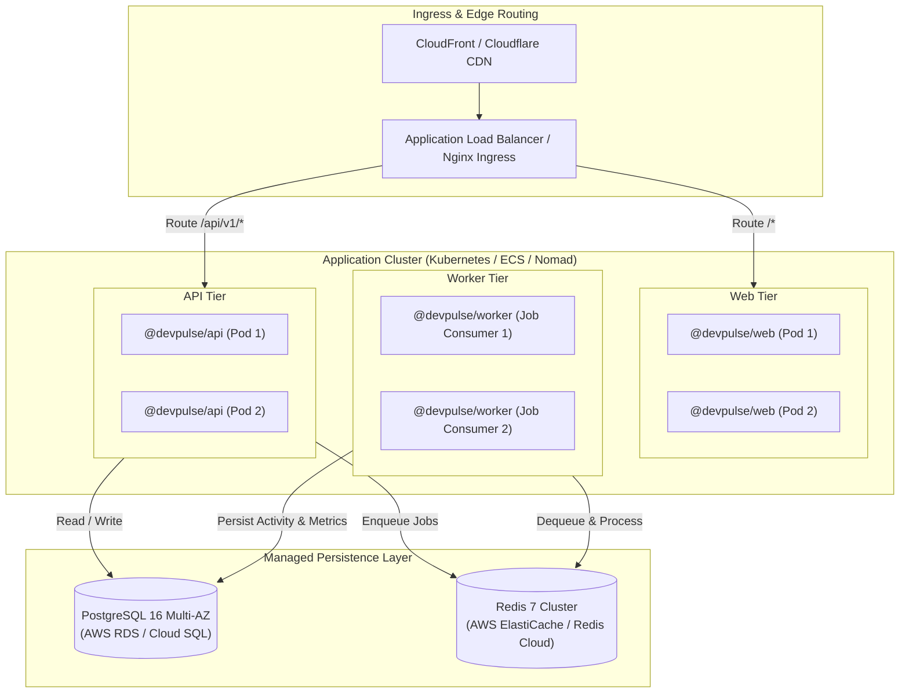
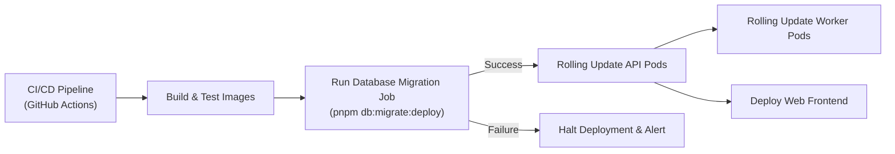

# Deployment & Infrastructure Overview

This document provides a high-level overview of the deployment architecture, containerization strategy, environment management, database migration pipeline, and orchestration health probes for **DevPulse**.

---

## 1. Deployment Topology

In a production environment, DevPulse components run as isolated containerized services connected to managed persistence layers:



---

## 2. Environments

DevPulse is structured across three standard environments:

| Environment | Purpose | Configuration Highlights |
|---|---|---|
| **Local Development** | Developer machines running via Docker Compose | Hot-reloading enabled, local PostgreSQL (`5433`) & Redis (`6379`), debug log levels. |
| **Staging** | Pre-production testing, QA, and webhook verification | Mirrors production topology, isolated test database, uses real GitHub OAuth staging app. |
| **Production** | Live production workloads | High-availability PostgreSQL, clustered Redis, strict secret enforcement, info/warn log level. |

> [!NOTE]
> For detailed instructions on running local Docker Compose infrastructure, refer to [Local Infrastructure Guide](local-infrastructure.md).

---

## 3. Production Environment & Secrets Management

When `NODE_ENV=production`, the `@devpulse/config` package strictly enforces production security rules:
- **Placeholder Rejection**: Startup fails immediately if default placeholder secrets (`devpulse_super_secret_jwt_key_32bytes!`, `dev_github_client_id`, etc.) are detected.
- **Key Length Requirements**: `JWT_SECRET`, `SESSION_SECRET`, and `ENCRYPTION_KEY` must each be at least 32 characters long.
- **SSL / HTTPS URLs**: `WEB_URL`, `API_URL`, and `GITHUB_CALLBACK_URL` must use secure HTTPS protocols.

### Secret Injection
Secrets should be injected via container orchestration mechanisms rather than committed to source control:
- **Kubernetes**: `Secret` objects mounted as environment variables.
- **AWS ECS**: Parameter Store or AWS Secrets Manager value references in Task Definitions.
- **CI/CD**: GitHub Actions Secrets or Doppler / HashiCorp Vault.

---

## 4. Database Migration Pipeline

Database schema migrations must be applied before rolling out new application container images:



### Applying Migrations in CI/CD
Run the non-interactive deployment migration command:
```bash
pnpm --filter @devpulse/database db:migrate:deploy
```
- Applies all pending SQL migration scripts located in `packages/database/prisma/migrations/`.
- Fails with a non-zero exit code if migrations cannot be applied safely, halting the deployment pipeline before service containers are updated.

---

## 5. Orchestration Health Probes & Scaling

To ensure zero-downtime rolling updates and automated self-healing in Kubernetes or ECS, configure container health probes against `@devpulse/api`:

### 5.1. Liveness Probe (`/api/v1/health/live`)
- **Purpose**: Verifies that the Node.js event loop is responsive and capable of handling HTTP requests.
- **Action on Failure**: Container orchestrator restarts the pod.
- **Recommended Configuration**:
  ```yaml
  livenessProbe:
    httpGet:
      path: /api/v1/health/live
      port: 3000
    initialDelaySeconds: 15
    periodSeconds: 10
    timeoutSeconds: 5
    failureThreshold: 3
  ```

### 5.2. Readiness Probe (`/api/v1/health/ready`)
- **Purpose**: Confirms that the API container can communicate with both PostgreSQL and Redis.
- **Action on Failure**: Container is removed from the load balancer pool to prevent user errors, but not restarted immediately.
- **Recommended Configuration**:
  ```yaml
  readinessProbe:
    httpGet:
      path: /api/v1/health/ready
      port: 3000
    initialDelaySeconds: 20
    periodSeconds: 15
    timeoutSeconds: 5
    failureThreshold: 2
  ```

### 5.3. Background Worker Graceful Shutdown
The `@devpulse/worker` listens for termination signals (`SIGTERM`, `SIGINT`) to close BullMQ queues cleanly:
- When a rollout occurs, the orchestrator issues `SIGTERM`.
- The worker stops accepting new jobs from Redis.
- The worker waits for active in-flight jobs to complete or reach a safe checkpoint before shutting down.
- Container orchestrator should allow a termination grace period of `30s` to `60s`.

---

## 6. Scaling Strategies

1. **API Tier (`@devpulse/api`)**:
   - Stateless HTTP workload.
   - Scale horizontally based on CPU utilization, memory, or request throughput (e.g. Horizontal Pod Autoscaler).
2. **Worker Tier (`@devpulse/worker`)**:
   - Background processing workload.
   - Scale horizontally based on Redis queue depth (`bullmq` job count) to drain large batches of webhook events or repository synchronizations.
3. **Database Tier**:
   - Vertical scaling with read replicas for analytics query offloading as data volume increases.
