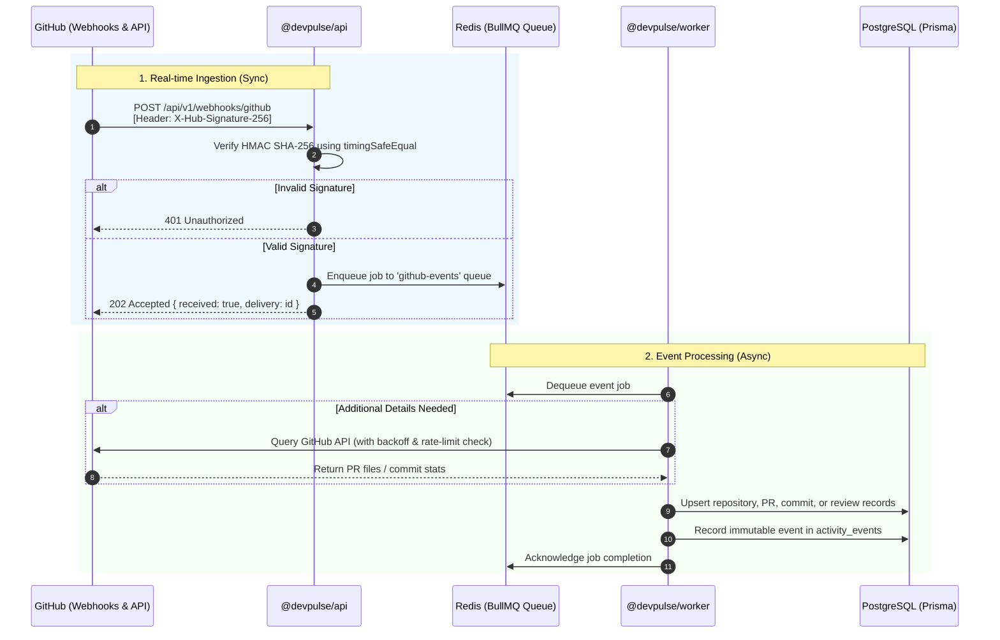

# GitHub Integration Guide

This guide details the GitHub integration architecture within **DevPulse**, including OAuth setup, webhook ingestion, HMAC signature verification, background worker processing, and rate-limit handling.

---

## 1. Overview

DevPulse relies on GitHub as its primary source of engineering activity data. The integration architecture consists of:
1. **`@devpulse/github`**: A dedicated, strongly-typed internal package managing GitHub REST API calls, OAuth token exchanges, and timing-safe webhook validation.
2. **`@devpulse/api`**: Ingests incoming GitHub webhooks (`POST /api/v1/webhooks/github`), validates HMAC SHA-256 signatures, and enqueues events onto Redis queues.
3. **`@devpulse/worker`**: Asynchronously dequeues webhook payloads, fetches missing metadata from GitHub, upserts domain records into PostgreSQL, and computes engineering metrics.

---

## 2. Integration Architecture & Data Flow



---

## 3. The `@devpulse/github` Package

All direct communication with the GitHub platform is isolated within `packages/github`.

### Package Submodules

```text
packages/github/src/
├── auth.ts          # OAuth authorization URL generation & code token exchange
├── client.ts        # Core GitHubClient with retries, timeout, and rate-limiting
├── commits.ts       # Commit history, commit details, comparisons
├── errors.ts        # Typed error hierarchy (GitHubRateLimitError, 401, 404, etc.)
├── issues.ts        # Issues and issue comments API
├── pull-requests.ts # Pull requests, changed files, diffs, PR commits
├── repositories.ts  # Repositories, branches, contributors, languages
├── reviews.ts       # PR review submissions, state tracking, review comments
├── types.ts         # TypeScript interfaces for API entities and webhooks
├── users.ts         # Authenticated user, profile lookups, emails, orgs
└── webhooks.ts      # HMAC SHA-256 signature verification & payload parsing
```

### Initializing the Client

```typescript
import { GitHubClient } from '@devpulse/github';

const github = new GitHubClient({
  token: process.env.GITHUB_TOKEN, // Personal access token or OAuth installation token
  oauthConfig: {
    clientId: process.env.GITHUB_CLIENT_ID!,
    clientSecret: process.env.GITHUB_CLIENT_SECRET!,
    callbackUrl: process.env.GITHUB_CALLBACK_URL,
  },
  webhookSecret: process.env.GITHUB_WEBHOOK_SECRET,
});
```

---

## 4. GitHub OAuth Setup Guide

DevPulse allows developers to link their GitHub identities to view their teams and repositories.

### 4.1. Creating a GitHub OAuth Application
1. In your GitHub account, navigate to **Settings** > **Developer Settings** > **OAuth Apps**.
2. Click **New OAuth App**.
3. Fill in the application details:
   - **Application name**: `DevPulse Local` (or `DevPulse Staging / Production`)
   - **Homepage URL**: `http://localhost:3000` (Next.js web URL)
   - **Authorization callback URL**: `http://localhost:3000/api/v1/auth/github/callback` (or your configured `GITHUB_CALLBACK_URL`)
4. Click **Register application**.
5. Copy the generated **Client ID**.
6. Generate and copy a new **Client Secret**.

### 4.2. Environment Configuration
Update your `.env` file with the generated credentials:
```env
GITHUB_CLIENT_ID=your_github_client_id_here
GITHUB_CLIENT_SECRET=your_github_client_secret_here
GITHUB_CALLBACK_URL=http://localhost:3000/api/v1/auth/github/callback
```

### 4.3. Required Scopes
DevPulse requests the following permissions during the OAuth authorization flow:
- `read:user`: To read profile information (username, avatar, name).
- `user:email`: To resolve and link commit author emails to DevPulse users.
- `repo`: To read repository metadata, commits, pull requests, and review comments for tracked repositories.

---

## 5. GitHub Webhook Configuration

Webhooks provide real-time updates when commits are pushed, pull requests are opened/merged, or code reviews are submitted.

### 5.1. Webhook Endpoint Setup
1. In your GitHub repository or organization, go to **Settings** > **Webhooks** > **Add webhook**.
2. Configure the webhook settings:
   - **Payload URL**: `https://<your-domain-or-tunnel>/api/v1/webhooks/github`
   - **Content type**: `application/json`
   - **Secret**: Set a secure secret string matching `GITHUB_WEBHOOK_SECRET` in your `.env`.
   - **SSL verification**: Enable SSL verification.
3. Select **Let me select individual events** and check:
   - `Pushes` (`push`)
   - `Pull requests` (`pull_request`)
   - `Pull request reviews` (`pull_request_review`)
   - `Issues` (`issues`)
   - `Releases` (`release`)
4. Save the webhook.

### 5.2. Timing-Safe Signature Verification
To prevent timing side-channel attacks, `@devpulse/github` uses constant-time comparison via Node.js `crypto.timingSafeEqual`:

```typescript
import { GitHubWebhooks } from '@devpulse/github';

const isValid = GitHubWebhooks.verifySignature({
  payload: rawPayloadStringOrBuffer,
  signature: req.headers['x-hub-signature-256'] as string,
  secret: process.env.GITHUB_WEBHOOK_SECRET!,
});

if (!isValid) {
  throw new UnauthorizedException('Invalid GitHub webhook signature');
}
```

### 5.3. Idempotency & Delivery Guarantees
GitHub sends a unique delivery GUID in the `X-GitHub-Delivery` header. DevPulse tracks this in the `activity_events` database table:
- **Column**: `github_delivery` (`VARCHAR(255) UNIQUE`)
- **Behavior**: If GitHub re-transmits a webhook event, the database unique constraint prevents duplicate processing and state corruption.

---

## 6. Rate Limiting & Resilience

GitHub enforces rate limits (e.g., 5,000 requests per hour for authenticated requests). The `@devpulse/github` package includes built-in safeguards:

1. **Header Inspection**: Every response extracts:
   - `x-ratelimit-limit`: Maximum request allowance.
   - `x-ratelimit-remaining`: Requests remaining in the current window.
   - `x-ratelimit-reset`: Unix timestamp when the quota resets.
2. **`GitHubRateLimitError`**: Thrown specifically when HTTP 403 / 429 indicates rate-limit exhaustion, containing the reset timestamp.
3. **Exponential Backoff**: Transient network errors (500, 502, 503, 504) automatically trigger exponential backoff retries with jitter.
4. **Budget Monitoring**: Workers inspect remaining rate limit capacity before launching large batch repository synchronizations.

---

## 7. Local Testing & Webhook Simulation

### 7.1. Exposing Localhost to GitHub
For local webhook testing without deploying to a public server, use a tunnel:
```bash
# Using ngrok
ngrok http 3000

# Using Smee.io
smee --url https://smee.io/your-unique-channel --target http://localhost:3000/api/v1/webhooks/github
```

### 7.2. Running Package Unit Tests
Run the automated test suite for `@devpulse/github`:
```bash
pnpm --filter @devpulse/github test
```
The test suite verifies:
- Client submodule instantiation
- OAuth authorization URL construction
- Webhook signature verification and invalid signature rejection
- Rate limit parsing and error hierarchy
