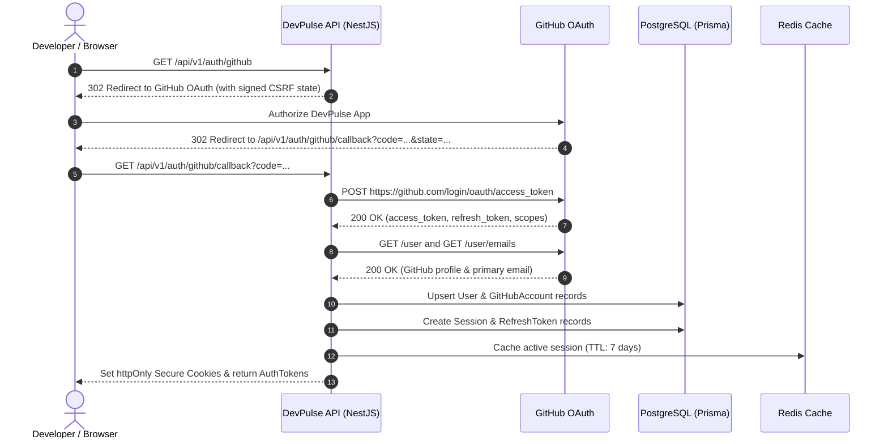
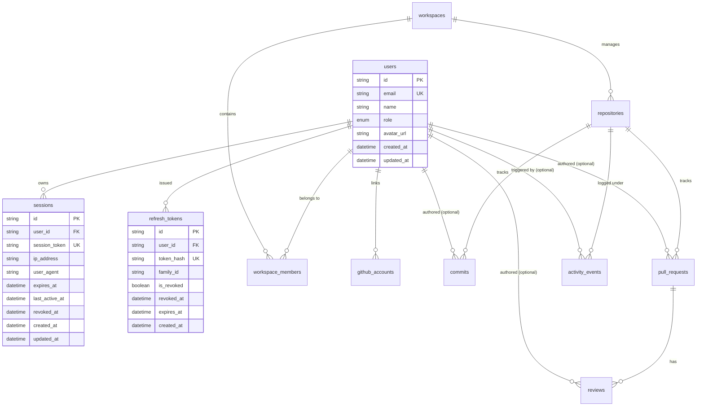

# Architecture & Security: Authentication Strategy & Session Lifecycle

## 1. Overview & Objectives

DevPulse authenticates developers, leads, and administrators primarily via **GitHub OAuth 2.0**, generating dual-layer session credentials:
1. **Stateless JWT Access Tokens** for rapid, decentralized request authorization across services.
2. **Stateful Database Sessions & Refresh Tokens** with rotation and family-based replay detection to enable secure long-lived sessions, remote logout, and audit visibility.

---

## 2. Authentication Strategy

### 2.1 Identity Providers & Sign-In Flows
- **Primary Flow (GitHub OAuth 2.0)**: Uses `@devpulse/github` (`GitHubAuthApi`) to generate signed OAuth challenge URLs (`read:user`, `user:email`, `repo`) with state parameter validation to mitigate CSRF.
- **Account Linking**: Users are keyed by verified primary email address. If an existing `User` matches the verified GitHub email, the `GitHubAccount` is linked under that user profile.
- **Service Accounts / Automation**: API key or scoped PAT (Personal Access Token) generation can map to specific workspace permissions in subsequent milestones.

### 2.2 Token Architecture

| Token Type | Storage / Delivery | Expiration | Purpose & Payload |
|---|---|---|---|
| **Access Token** | Memory / Authorization Bearer Header | **15 minutes** | Signed JWT (`sub`, `email`, `role`, `sessionId`). Authenticates REST requests without hitting DB on every call. |
| **Refresh Token** | `httpOnly`, `Secure`, `SameSite=Lax` Cookie | **7 days** (rolling) | Opaque cryptographically secure random token (stored hashed with SHA-256). Used strictly to exchange for fresh token pairs. |
| **Session Record** | PostgreSQL (`sessions` table) & Redis cache | **7 days** | Tracks device metadata (`ipAddress`, `userAgent`), last active timestamp, and revocation status for active dashboard sessions. |

---

## 3. Session Lifecycle Management

### 3.1 Session Creation
1. Upon successful GitHub OAuth exchange, a new `Session` entity is created in PostgreSQL with `session_token`, client IP address, and `User-Agent`.
2. A cryptographic `family_id` is assigned to group rotated refresh tokens.
3. The active session is mirrored into Redis with a 7-day TTL (`session:<sessionToken>`) for sub-millisecond session validation during revocation checks.

### 3.2 Token Refresh & Replay Detection
- Every `/api/v1/auth/refresh` request sends the refresh token cookie.
- The server validates the SHA-256 hash of the token against `refresh_tokens`.
- **Automatic Rotation**: The used refresh token is marked as revoked (`is_revoked = true`, `revoked_at = now()`), and a new refresh token is issued under the same `family_id`.
- **Replay Attack Detection**: If an already-revoked refresh token is presented, the system detects a breach or token compromise:
  - All refresh tokens sharing that `family_id` are immediately revoked.
  - The associated `Session` is terminated.
  - An audit warning is logged.

### 3.3 Session Revocation & Logout
- **Single Session Logout** (`POST /api/v1/auth/logout`): Marks the specific `Session` as revoked, deletes the Redis key, revokes active refresh tokens, and clears cookies.
- **All-Device Logout** (`POST /api/v1/auth/logout-all`): Revokes all sessions and refresh tokens where `userId = current_user.id`. Clears Redis session patterns.
- **Inactivity & Expiry**: Sessions older than `expiresAt` (default 7 days) are invalid. Background cleanup jobs prune expired tokens.

---

## 4. Database Schema Specification

### 4.1 Updated Entity Relationship Diagram

### 4.2 Model Definitions

#### `Session` (`sessions`)
| Column | Type | Constraints | Description |
|---|---|---|---|
| `id` | `UUID` / `String` | `PRIMARY KEY` | Unique session record ID |
| `user_id` | `String` | `FOREIGN KEY (users.id) ON DELETE CASCADE` | Associated user |
| `session_token` | `String` | `UNIQUE`, Indexed | Random session identifier stored in client / cookie |
| `ip_address` | `String?` | Nullable | Client IP at login |
| `user_agent` | `String?` | Nullable | Browser / Device user agent string |
| `expires_at` | `DateTime` | Indexed | Hard expiration timestamp |
| `last_active_at`| `DateTime` | Default `now()` | Sliding activity tracking |
| `revoked_at` | `DateTime?` | Nullable | Revocation timestamp if terminated early |
| `created_at` | `DateTime` | Default `now()` | Creation timestamp |
| `updated_at` | `DateTime` | `updatedAt` | Last modification timestamp |

#### `RefreshToken` (`refresh_tokens`)
| Column | Type | Constraints | Description |
|---|---|---|---|
| `id` | `UUID` / `String` | `PRIMARY KEY` | Unique token ID |
| `user_id` | `String` | `FOREIGN KEY (users.id) ON DELETE CASCADE` | Associated user |
| `token_hash` | `String` | `UNIQUE` | SHA-256 hash of plaintext refresh token |
| `family_id` | `String` | Indexed | Grouping identifier for rotated tokens |
| `is_revoked` | `Boolean` | Default `false` | Revocation status flag |
| `revoked_at` | `DateTime?` | Nullable | Revocation timestamp |
| `expires_at` | `DateTime` | Indexed | Token expiration timestamp |
| `created_at` | `DateTime` | Default `now()` | Creation timestamp |
